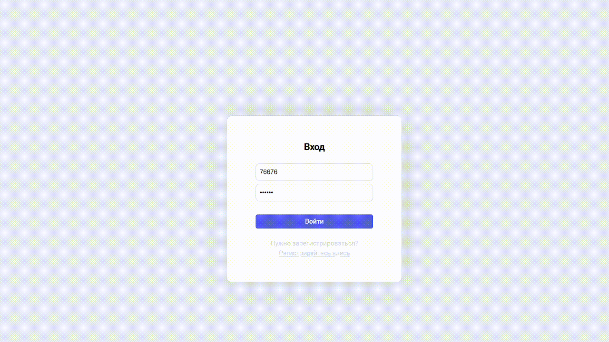

# 🌷 Kanban

*Приложение для управления задачами и планирования работы.*

Kanban — это доска, на которой можно создавать задачи, распределять их по этапам и следить за их выполнением. Карточки можно перемещать между колонками и менять их порядок с помощью **Drag & Drop**.

---

## 🌸 Демонстрация проекта



## ✨ Возможности

- Регистрация, авторизация и выход из аккаунта.
- Создание, редактирование и удаление задач.
- Просмотр подробной информации о задаче.
- Распределение задач по колонкам в зависимости от статуса.
- Перемещение карточек между колонками с помощью **Drag & Drop**.
- Изменение порядка карточек внутри колонок.
- Сохранение изменений задач на сервере.
- Сохранение порядка карточек в `localStorage`.
- Хранение временных данных с помощью `sessionStorage`.
- Переключение между светлой и тёмной темами.
- Защита страниц от доступа без авторизации.

---

## 🎨 Статусы задач

На доске предусмотрено пять колонок:

| Статус | Описание |
|:---|:---|
| Без статуса | Задачи без определённого этапа |
| Нужно сделать | Задачи, ожидающие выполнения |
| В работе | Задачи, над которыми ведётся работа |
| Тестирование | Задачи на этапе проверки |
| Готово | Завершённые задачи |

---

## 🛠 Технологии

| Технология | Использование |
|:---|:---|
| **React** | Создание интерфейса |
| **JavaScript** | Логика приложения |
| **React Router** | Навигация между страницами |
| **React Context API** | Управление общим состоянием |
| **styled-components** | Стилизация компонентов |
| **Axios** | Работа с API |
| **@dnd-kit/react** | Перетаскивание карточек |
| **@dnd-kit/helpers** | Изменение порядка элементов |
| **Vite** | Сборка и запуск проекта |

---

## 🚀 Запуск проекта

**1. Клонировать репозиторий**

```bash
git clone https://github.com/MethodGirl/skypro-kanban.git
